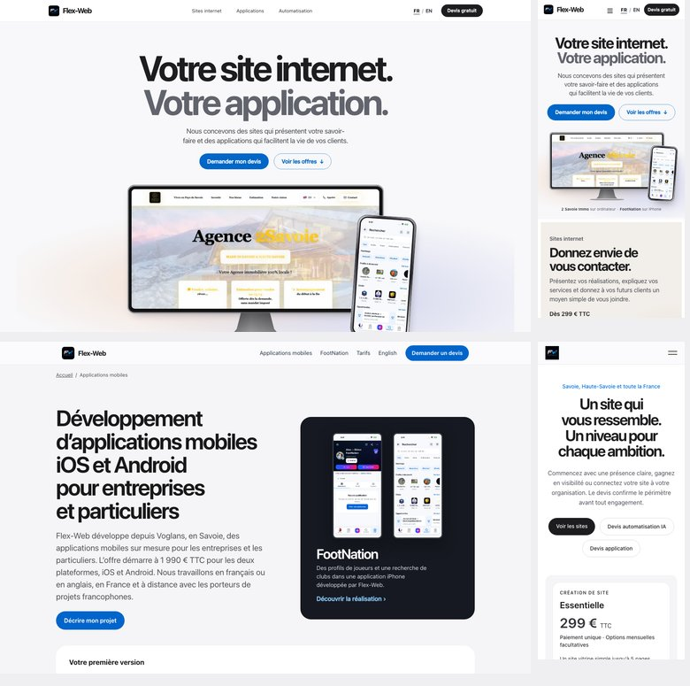

# Refonte Flex-Web du 23 novembre 2026

## Page Contact et menu de l’accueil

« Contact » est la quatrième entrée du menu des accueils français et anglais. Le lien mène à la page dédiée de la langue choisie. En français, la page propose l’appel, l’e-mail, l’adresse postale, les horaires et le formulaire de devis général. [Accueil](https://6b04b0901a10a257d97f8a2a--flex-webb.netlify.app/) · [Contact en français](https://6b04b0901a10a257d97f8a2a--flex-webb.netlify.app/contact/) · [Contact en anglais](https://6b04b0901a10a257d97f8a2a--flex-webb.netlify.app/en/contact/)

Le test navigateur de l’aperçu a réussi sur 41 affichages. Huit clics sur « Contact », dans les deux langues à 320, 390, 768 et 1 440 px, ont ouvert une page HTTP 200 avec les bons liens d’appel, d’e-mail et de devis. Le sitemap compte 151 507 URL dans 85 sous-sitemaps. Par rapport au brouillon précédent, seuls les HTML des deux accueils et de la page Contact française ont changé.

Des essais répétés en local ont aussi révélé une erreur intermittente de mise en place du pied de page sur des modèles historiques du catalogue. L’erreur a été reproduite avec le brouillon précédent sur une fiche suisse auxiliaire. Les huit parcours Contact testés sur le nouvel aperçu ont abouti sans erreur.

## Adresse du pied de page

Le pied de page affiche « Flex Web by Flex Immo », 93 chemin de la Combe, 73420 Voglans, France. Les deux accueils, les offres et les devis servent les coordonnées dans leur HTML. Les modèles archivés utilisent leurs ressources communes pour afficher le même bloc, avec un affichage de repli quand JavaScript est désactivé. Les démonstrations de sites clients gardent leurs propres coordonnées. [Voir le pied de page](https://6b04aceb97d3a6cb2155e5c9--flex-webb.netlify.app/#coordonnees) · [Mentions légales](https://flex-web.fr/mentions-legales/)

Les 22 contrôles sur 11 pages à 390 et 1 440 px ont retrouvé une seule adresse visible par pied de page et ont ouvert les préférences de cookies. Le contrôle de navigation sur 39 affichages a réussi. Le sitemap de l’aperçu contient 151 507 URL dans 85 sous-sitemaps. [Sitemap](https://6b04aceb97d3a6cb2155e5c9--flex-webb.netlify.app/sitemap.xml)

## Aperçu précédent avec les trois offres françaises

Le brouillon Netlify `6b04a78f0f68c45095100b52` simplifie trois pages du premier aperçu. La comparaison des 160 330 fichiers hébergés confirme trois HTML modifiés et 160 327 empreintes identiques, dont celles des deux accueils, des formulaires et des 85 sous-sitemaps. Le sitemap compte 151 507 URL uniques. [Manifeste de l’aperçu des trois offres](https://github.com/ProjetMario/FLEXWEB/blob/3dee403/acquisition-mobile/redesign/release-candidate.json) · [Sitemap](https://6b04a78f0f68c45095100b52--flex-webb.netlify.app/sitemap.xml)

| Offre | Ce que le visiteur peut décider | Mots visibles sur mobile, avant → après |
|---|---|---:|
| [Application iOS et Android](https://6b04a78f0f68c45095100b52--flex-webb.netlify.app/creation-application-mobile/) | Examiner une vraie capture de FootNation, consulter les trois fourchettes de budget et préparer son devis dès 1 990 € TTC | 465 → 291 |
| [Automatisation IA](https://6b04a78f0f68c45095100b52--flex-webb.netlify.app/automatisation-ia/) | Suivre un exemple de demande transmise au CRM avec validation humaine, puis décrire sa propre tâche pour un chiffrage sur devis | 752 → 239 |
| [Création de site internet](https://6b04a78f0f68c45095100b52--flex-webb.netlify.app/creation-site-internet/) | Voir 2 Savoie Immo et choisir Essentielle à 299 € TTC, Business à 590 € TTC ou Premium dès 990 € TTC | 371 → 177 |

Les mots sont comptés dans le contenu principal affiché à 390 px, accordéons fermés. Les trois pages ont chacune un seul titre H1. L’ancienne page de création de site contenait deux éléments main imbriqués, le nouvel HTML en contient un seul. Le contrôle Playwright a couvert quatre largeurs, le menu à 320 px, les FAQ au clavier, leurs données structurées, 28 liens et ancres et six entrées vers le devis. Les six affichent la prestation et le tarif attendus. Aucun formulaire de test n’a été envoyé. Axe a contrôlé 24 états, accordéons ouverts puis fermés, sans anomalie détectée dans l’échantillon.


Les trois composants Astro se trouvent dans `offers/src/components/`. Le build partagé exécute leur compilation et intègre le contenu rendu et ses styles dans les documents du catalogue de référence. Le navigateur reçoit directement le HTML, avec les métadonnées, la navigation et les intégrations du site. Le circuit GitHub de la refonte utilise les formulaires et les tarifs du site hébergé. Le build CMS historique possède un autre catalogue de formules.

## Premier aperçu de la refonte

Les accueils français et anglais présentent les réalisations de Flex-Web dans une composition inspirée de la vitrine d’Apple France. Le premier écran met en scène le site de 2 Savoie Immo sur ordinateur et FootNation sur téléphone. Les offres de sites, d’applications et d’automatisation conduisent aux pages de service ou au devis. [Accueil français](https://6b04a05bc3647bd53a28174f--flex-webb.netlify.app/) · [Accueil anglais](https://6b04a05bc3647bd53a28174f--flex-webb.netlify.app/en/) · [Applications](https://6b04a05bc3647bd53a28174f--flex-webb.netlify.app/creation-application-mobile/)



## Catalogue et gabarits

Le brouillon Netlify est construit sur le catalogue complet `6b04922cb721fd1ae1c8d810`. L’assemblage reprend son manifeste de fichiers, remplace les deux accueils et les pages qui demandent du HTML spécifique, puis distribue les styles intérieurs aux gabarits historiques par leurs trois feuilles de style partagées. Les 41 sélecteurs de langue concernés affichent le nom complet, y compris après hydratation. Les trois démonstrations de sites clients conservent leurs identités graphiques. [Manifeste du premier aperçu](https://github.com/ProjetMario/FLEXWEB/blob/1dbd8f61c33fdc98dae0600e9b17a7e74e10a60d/acquisition-mobile/redesign/release-candidate.json) · [Sitemap de l’aperçu](https://6b04a05bc3647bd53a28174f--flex-webb.netlify.app/sitemap.xml)

## Résultats du premier aperçu

| Vérification | Résultat |
|---|---|
| Sitemap et livraison | 151 507 URL uniques dans 85 sous-sitemaps. Les 86 XML ont été comparés au catalogue complet. L’artefact contient 160 330 fichiers, dont huit nouvelles ressources visuelles. |
| HTML et dépendances | 151 507 empreintes vérifiées. Parmi les HTML du sitemap, 151 191 correspondent exactement à l’archive certifiée et les 316 autres ont été relus directement. Avec l’échantillon complémentaire, 394 pages ont répondu en HTTP 200 et passé les contrôles de structure. Les 8 592 pages auxiliaires et leurs exclusions du sitemap sont préservées. |
| Navigation | 66 parcours réussis sur 22 pages représentant 19 familles, aux largeurs de 390, 768 et 1 440 px. Chaque parcours a suivi un lien jusqu’à une seconde page. Français, anglais, allemand et italien couverts. |
| Pages commerciales et de service | 39 affichages supplémentaires, dont les deux accueils, les tarifs, les formulaires, la confidentialité, une page en noindex et une véritable réponse 404. Les 18 pages de l’offre mobile et des études de cas ont également été vérifiées à deux largeurs, avec 29 destinations internes et quatre références publiques. |
| Accessibilité | Aucune anomalie détectée par axe-core 4.14.0 sur les huit pages choisies, à deux largeurs. Le clavier a été testé sur le menu et les actions de l’accueil. Les 41 liens de changement de langue corrigés ont été vérifiés après hydratation. |
| Devis | Quatre essais des formulaires FR/EN et sept scénarios du parcours de devis. Le consentement, le refus, l’erreur et le succès simulés ont été vérifiés. Aucun envoi commercial réel. |
| Publication et CMS | 183 tests CMS et 11 tests d’inventaire, d’analyse et de construction du manifeste réussis. Les deux fonctions Netlify, la planification et les règles de routage proviennent du déploiement de référence. |

### Temps de chargement mobile

Mesures de laboratoire dans Chromium à 390 px, cache froid, 100 ms de latence, 200 000 octets/s en réception et processeur ralenti quatre fois. Les valeurs ci-dessous sont les médianes de trois chargements pour chaque version. Le LCP correspond à l’affichage du plus grand élément visible.

| Page | LCP avant | LCP refonte | Transfert avant → après | CLS avant / après |
|---|---:|---:|---:|---:|
| Accueil français | 3,59 s | 1,32 s | 715 → 484 ko | 0 / 0 |
| Offre applications mobiles | 0,54 s | 0,67 s | 317 → 461 ko | 0 / 0 |

L’offre mobile affiche désormais deux captures réelles de FootNation. Le poids supérieur est mesuré sur cette page. Les données de terrain dépendront des appareils des visiteurs, du réseau et du cache du domaine de production.

### Mesure des demandes

Le suivi du début de saisie avec consentement a réussi dans les trois scénarios du formulaire monopage. Deux anciens tests échouent sur la question facultative « Comment nous avez-vous connu ? », déjà absente du formulaire de production. Les demandes arrivent par le parcours habituel. Une provenance GPT ou Gemini déclarée par le prospect ne peut donc pas être recueillie par ce champ. Les clics de contact, les référents mesurables et les demandes effectivement reçues restent des signaux distincts.

## Reproduire les contrôles

Le workflow d’aperçu construit les accueils Astro, prépare les styles et les transformations HTML, puis valide le résultat sélectivement en navigateur et exhaustivement par rapprochement des XML et des empreintes de fichiers. Les contrôles de navigation et de devis utilisent Playwright. Les essais de formulaire interceptent les envois. [Workflow d’aperçu](../../.github/workflows/design-preview.yml) · [Sources des accueils](home/README.md)

Après `npm ci` et l’installation du navigateur Playwright, ces commandes vérifient l’aperçu existant depuis la racine du dépôt. L’audit des fichiers a besoin de l’accès Netlify du projet.

```sh
apercu=https://6b04a78f0f68c45095100b52--flex-webb.netlify.app
node acquisition-mobile/catalogue/inventory.mjs
node acquisition-mobile/catalogue/check.mjs "$apercu" --exact
node acquisition-mobile/catalogue/audit/verify.mjs 6b04a78f0f68c45095100b52
node acquisition-mobile/catalogue/browser.mjs "$apercu" --design
node acquisition-mobile/redesign/verify.mjs "$apercu"
node acquisition-mobile/redesign/offers/verify.mjs "$apercu"
node acquisition-mobile/scripts/verify-pages.mjs "$apercu"
node acquisition-mobile/scripts/verify-quote.mjs "$apercu"
node acquisition-mobile/redesign/performance.mjs "$apercu"
```

## Production

L’aperçu porte une adresse Netlify distincte. Le domaine public servait un sitemap de 258 URL lors de la vérification du 23 novembre. Après validation de l’aperçu et fusion sur `main`, le workflow de publication accepte l’identifiant exact du reçu. Il recontrôle le catalogue et les parcours commerciaux avant et après publication. Les soumissions Google et Bing concernent le domaine public après cette étape. [Workflow de publication](../../.github/workflows/mobile-acquisition-publish.yml)
